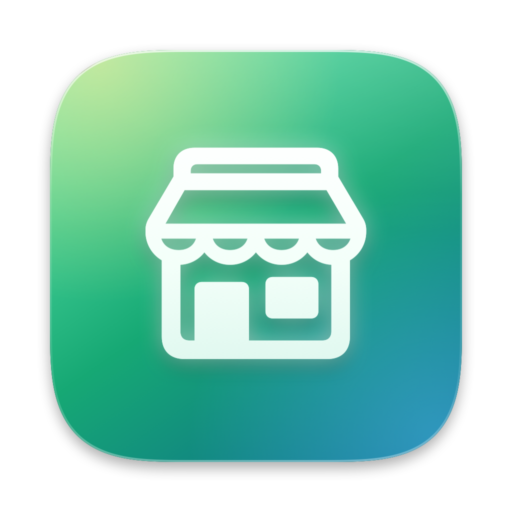

<div align="center">

[](https://github.com/IGOLz/facebook-marketplace-external-filter/releases/latest)


[](LICENSE)



# Facebook Marketplace External Filter

### Hide Facebook Marketplace listings imported from external sites. See only what people posted on Facebook.

[Install](#install) · [How it works](#how-it-works) · [Privacy](#privacy) · [Development](#development)

</div>

## Why

Facebook Marketplace mixes in **partner listings**: items imported from other marketplaces such as Gul&Gratis, Catawiki or eBay. They look like normal listings, but they are often in another country, priced in a converted currency, and open on the external site (*View on Gul&Gratis*). In some areas they make up most of the feed.

This extension removes them, so the grid only shows listings published on Facebook.

## Install

The extension works in Chromium browsers: Brave, Chrome, Edge, Arc, Vivaldi.

1. Download `facebook-marketplace-external-filter-<version>.zip` from the [latest release](https://github.com/IGOLz/facebook-marketplace-external-filter/releases/latest) and unzip it, or clone this repo.
2. Open `brave://extensions` (or `chrome://extensions`) and turn on **Developer mode**.
3. Click **Load unpacked** and select the unzipped folder (the one containing `manifest.json`).
4. Open [Facebook Marketplace](https://www.facebook.com/marketplace/). Pin the extension to see how many partner listings it filtered.

To update, replace the folder with the new version and press the reload button on the extension card.

## Features

- Hides partner listings in the Marketplace feed and in the recommendations under a listing.
- Works while you scroll: new cards are checked as Facebook loads them.
- **Hide** or **Dim** mode: dim keeps partner listings visible but faded, handy to check what gets filtered.
- On/off switch and a counter on the toolbar badge.
- English and Italian interface.

> [!NOTE]
> Facebook loads the feed in batches, so hiding cards can leave some rows shorter than others. If your area has few native listings, the feed can look sparse: that is what is left once partner listings are gone.

## How it works

Every Marketplace card links to `/marketplace/item/<id>/`. For each card the extension checks, in order:

1. **The ranking data in the link.** The `tracking` parameter contains a `commerce_rank_obj` with `upsell_type: 212` for partner listings (`129` for native ones) and a retrieval source of `5021`. This does not depend on the interface language.
2. **The partner badge.** Partner cards show an icon and a *Partner listing* label; native cards have no icon inside the link. This is the fallback for links without ranking data.

Matching cards are marked and hidden with CSS. Nothing is removed from the page, so turning the extension off restores them instantly.

> [!WARNING]
> These are undocumented Facebook internals and may change. If partner listings start showing up again, [open an issue](https://github.com/IGOLz/facebook-marketplace-external-filter/issues).

## Privacy

The extension runs only on `facebook.com`, reads the page you are viewing and stores two settings (on/off and mode) in your browser's extension storage. It makes no network requests, collects no data and has no analytics.

## Development

<details>
<summary>Project structure, tests and packaging</summary>

```
manifest.json          MV3 manifest
src/detect.js          partner listing detection (pure, unit tested)
src/content.js         marks cards, applies hide/dim, watches DOM changes
src/background.js      toolbar badge counter
src/popup.*            settings popup
_locales/              en, it strings
icons/                 toolbar and store icons
.github/assets/        icon.png and make-icon.swift (regenerates the icon)
```

```sh
node --test test/                 # run tests
./scripts/package.sh              # build dist/facebook-marketplace-external-filter-<version>.zip
swift .github/assets/make-icon.swift .github/assets/icon.png
for s in 16 32 48 128; do sips -z $s $s .github/assets/icon.png --out icons/icon-$s.png; done
```

</details>

## License

[MIT](LICENSE)

Not affiliated with Meta or Facebook.
